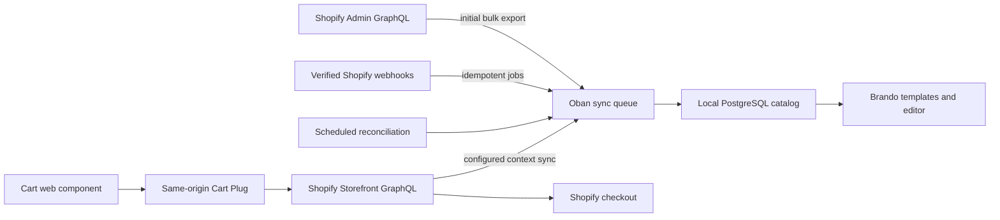

# BrandoShopify

A local-first Shopify commerce integration for Brando CMS.

BrandoShopify synchronizes Shopify products into the application's PostgreSQL
database, so product pages, templates, editorial relationships, listings, and
search do **not** call Shopify during normal rendering. Configured country and
language views are synchronized into local contextual projections as well.
Shopify remains the commerce source of truth and is contacted by background
synchronization, carts, and checkout—not implicitly by templates.

The package targets Shopify's stable `2026-07` GraphQL APIs and includes:

- local Ecto projections for products, variants, configured market/language
  views, media, collections, SEO, metafields, and location inventory;
- Admin GraphQL pagination and streamed bulk imports;
- HMAC-verified, idempotent webhooks backed by Oban;
- scheduled reconciliation to repair missed or out-of-order webhooks;
- background Storefront GraphQL projection sync for configured contexts and
  optional selling plans;
- a server-side Cart API that keeps Shopify's secret cart ID out of browser code;
- an accessible, styleable `<brando-shopify-cart>` web component; and
- multi-store and runtime token-rotation support.

## Data flow



## Installation

Until the package is published, add the sibling dependency:

```elixir
def deps do
  [
    {:brando_shopify, path: "../brando_shopify"}
  ]
end
```

Then install and migrate the local catalog:

```console
mix deps.get
mix brando_shopify.install
mix ecto.migrate
```

Configure the store in your Brando application's `config/runtime.exs`. Like the
standard Brando runtime configuration, this reads deployment secrets when the
application starts rather than when the release is compiled:

```elixir
# config/runtime.exs
import Config

config :brando_shopify,
  stores: [
    default: [
      shop_domain: "example.myshopify.com",
      storefront_domain: "shop.example.com",
      api_version: "2026-07",
      admin_access_token: System.fetch_env!("SHOPIFY_ADMIN_ACCESS_TOKEN"),
      storefront_access_token: System.fetch_env!("SHOPIFY_STOREFRONT_PRIVATE_TOKEN"),
      storefront_token_type: :private,
      webhook_secret: System.fetch_env!("SHOPIFY_CLIENT_SECRET"),
      repo: MyApp.Repo,
      oban_name: Oban,
      catalog_contexts: [
        norway: [country: "NO", language: "NB"],
        united_states: [country: "US", language: "EN"]
      ],
      visibility: :live
    ]
  ]
```

String values are sufficient for normal deployments and token rotation through
an application restart. BrandoShopify also accepts zero-arity functions and MFA
tuples as secret sources when an application must resolve a newly rotated token
without restarting.

### Launching a store

A store is filled with products long before it opens. `:visibility` says who is
allowed to see it:

| State | Public | Vouched-for visitor |
| --- | --- | --- |
| `:live` (default) | storefront | storefront |
| `:preview` | hidden | storefront, `noindex` |
| `:off` | hidden | hidden |

`:preview` is the state worth reaching for: the people entering products see the
real site with real data, while buyers still go wherever they went before.

Enforce it on buyer-facing pipelines with `BrandoShopify.Plug.Visibility`, and
branch navigation and sitemaps on `BrandoShopify.live?/1`. Never gate the
webhook pipeline — sync keeps the catalog warm while the store is closed, which
is what makes launch a single switch.

`:visibility` takes the same literal, function and MFA sources as secrets, so
the state can live in the CMS and be flipped without a deploy:

```elixir
visibility: {MyApp.Shop, :visibility, []}
```

## Storefront components

`BrandoShopify.Components.Catalog` and `BrandoShopify.Components.Cart` render the
catalogue and the cart. Every component works with no slots at all, and every
part of one can be replaced without giving up the rest.

```heex
<.product_grid products={@products} href={&~p"/shop/#{&1.handle}"} />
```

Slots receive **presented** data — prices formatted, images flattened,
availability resolved — so overriding markup does not mean re-deriving what the
default had:

```heex
<.product_card product={@product} href={@href}>
  <:badge :let={p}><span :if={p.sold_out?}>Sold out</span></:badge>
</.product_card>
```

To scaffold the wiring around them — a context with the partner rule, a
controller, templates:

```bash
mix brando_shopify.gen.shop --path /shop --partner-collections partner-one
```

It generates the parts the package cannot know: your routes and your partner
collections. The components stay in the package, so improvements reach you
rather than freezing into a copy.

See [Brando integration](docs/brando-integration.md) for the slots each one
exposes, and [Cart](docs/cart.md) for the cart element.

## Admin screens

The Brando admin can show what the sync stores — products, collections and
recent sync runs, with buttons to fetch changes or start a full import:

```bash
mix brando_shopify.gen.admin --shop-path /shop
```

The screens are generated into your application rather than shipped, because
they are built on Brando's admin and this package does not depend on Brando.
Products and collections are read-only there: Shopify owns them, and the next
webhook would overwrite an edit, so each row links to the Shopify admin. The
task prints the router and menu lines to add.

A full import completes through Shopify's `bulk_operations/finish` webhook, so
on a machine Shopify cannot reach, use "Fetch changes" instead.

It also generates a settings screen. The store's launch state and its partner
collections are saved in `shopify_settings` (`BrandoShopify.Settings`), so
opening the shop is a click in the admin rather than a deploy:

```elixir
visibility: {BrandoShopify.Settings, :visibility, [:default, :preview]}
```

The last argument is the state until one is saved — `:preview` keeps a fresh
deployment from opening the shop on its own.

## Oban

Every worker in this package runs on the `:shopify` queue. Without it, jobs are
inserted and never execute:

```elixir
config :my_app, Oban,
  repo: MyApp.Repo,
  queues: [default: 10, shopify: 5]
```

**In a Brando host, Oban is configured as `config :brando, Oban` — and setting it
replaces Brando's default outright.** From `Brando.Supervisor`:

> an app-level `config :brando, Oban` REPLACES this entire default — queues AND
> the cron jobs below are lost, not merged.

So adding `shopify: 5` means copying Brando's whole default back first: every
queue, the `Cron`/`Pruner`/`Lifeline` plugins, and every cron job. Copy them
from `Brando.Supervisor.oban_config/0` in the version you are on, and re-diff on
every upgrade: the list grows. Brando 0.55 added the `content_events`,
`webhooks`, `notifications` and `search_index` queues and six cron jobs,
including the scheduled-publishing sweep; without the queues, Brando's webhooks,
notifications and admin search index never run (`mix brando.doctor` reports
missing queues). Two things quietly break otherwise — Brando's nightly
sitemap, revision and media cleanup stop running, and `config :my_app,
cron_jobs:` stops being read, because Brando appended it through
`extra_oban_cron_jobs/0` and that call goes with the default. Anything scheduled
there — including `BrandoShopify.Workers.Reconcile` — has to move into the
crontab you now own.

Mount the webhook receiver in the endpoint **before** `Plug.Parsers`:

```elixir
plug BrandoShopify.Plug.Webhook,
  at: "/shopify/webhooks",
  store: :default

plug Plug.Parsers,
  parsers: [:urlencoded, :multipart, :json],
  pass: ["*/*"],
  json_decoder: Phoenix.json_library()
```

Mount the JSON cart behind its own session and CSRF-protected pipeline. A
typical Phoenix browser pipeline accepts only HTML and will reject the web
component's `Accept: application/json` requests:

```elixir
pipeline :shopify_cart do
  plug :accepts, ["json"]
  plug :fetch_session
  plug :protect_from_forgery
  plug :put_secure_browser_headers
end

scope "/shopify" do
  pipe_through :shopify_cart

  forward "/cart", BrandoShopify.Plug.Cart,
    store: :default
end
```

Render Brando's CSRF component in the storefront layout so the cart component
can send the matching `x-csrf-token` header:

```heex
<.csrf_meta_tag />
```

The Cart Plug encrypts the Shopify cart ID with Phoenix's
`conn.secret_key_base` before placing it in the session, including when the
host's cookie session is signed but not itself encrypted.

See [Shopify setup](docs/shopify-setup.md) for scopes, webhook topics, initial
sync, and reconciliation.

## Local template rendering

Load a product from the local database in a controller, LiveView, or Brando
datasource:

```elixir
product =
  BrandoShopify.Catalog.get_product_by_handle!(params["handle"],
    preload: [variants: [inventory_item: :levels], collections: []]
  )
```

For the Shopify Admin/default-shop view, use the base projection normally:

```heex
<article :if={@product}>
  <h1>{@product.title}</h1>
  {Phoenix.HTML.raw(@product.description_html)}

  

  <button
    :for={variant <- @product.variants}
    type="button"
    data-shopify-variant={variant.shopify_id}
  >
    {variant.title} — {variant.price} {variant.currency_code}
  </button>
</article>
```

This performs Ecto queries only. A storefront with Markets or translated
catalog content should render a configured context instead:

```elixir
product =
  BrandoShopify.Catalog.get_contextual_product_by_handle(
    params["handle"],
    :norway,
    preload: [variants: [inventory_item: :levels], collections: []]
  )
```

```heex
<article :if={@product}>
  <h1>{@product.title}</h1>
  {Phoenix.HTML.raw(@product.description_html)}

  <button :for={variant <- @product.variants} data-shopify-variant={variant.shopify_id}>
    {variant.title} — {variant.price} {variant.currency_code}
  </button>
</article>
```

The second query is also local. Product sync obtains the translated content,
country-aware prices, availability, and optional selling plans through
Storefront GraphQL in the background. If `:norway` has not been synchronized,
the query returns `nil`; it never substitutes a base or different-market price.
Sync verifies Shopify's returned context extension before writing the row.
Use `BrandoShopify.Catalog.fresh?/2` when a page needs an explicit maximum-age
policy.

With those preloads, a contextual variant exposes its base inventory item and
active location levels as `variant.inventory_item.levels`; the contextual
`price`, `currency_code`, `available_for_sale`, and `quantity_available` remain
direct fields on the contextual variant.

## Cart UI

Import the optional assets from the host application's asset entrypoints:

```js
import "../../deps/brando_shopify/assets/js/cart.js";
import "../../deps/brando_shopify/assets/css/cart.css";
```

```html
<button type="button" onclick="document.querySelector('brando-shopify-cart').open()">
  Cart
</button>
<brando-shopify-cart endpoint="/shopify/cart"></brando-shopify-cart>
```

Add a variant without exposing Storefront credentials or a cart secret:

```js
document
  .querySelector("brando-shopify-cart")
  .add("gid://shopify/ProductVariant/123", 1);
```

For a synchronized selling-plan allocation, pass its plan ID explicitly:

```js
cart.add(variantId, 1, [], { sellingPlanId });
```

### Styling the default drawer

Override the component's CSS variables in the host stylesheet:

```css
:root {
  --brando-cart-width: min(38rem, 100vw);
  --brando-cart-bg: #f7f3ed;
  --brando-cart-fg: #1d1b19;
  --brando-cart-accent: #c34a2c;
  --brando-cart-accent-fg: #fff;
  --brando-cart-radius: 0.5rem;
  --brando-cart-gap: 1.5rem;
}

.brando-cart__checkout {
  text-transform: uppercase;
  letter-spacing: 0.08em;
}
```

The default renderer uses light DOM. Its `brando-cart__*` classes and `part`
attributes are stable styling hooks; target a part with an attribute selector,
for example `brando-shopify-cart [part~="checkout"]`. CSS `::part()` is not used
because the component does not create a shadow root.

### Component behavior

Common attributes are:

| Attribute | Effect |
|---|---|
| `endpoint` | Same-origin Cart Plug URL; defaults to `/shopify/cart` |
| `open` | Opens the drawer and reflects its visible state |
| `manual` | Disables the automatic initial `refresh()` |
| `headless` | Disables the built-in DOM renderer while retaining state, methods, and events |
| `aria-label` | Overrides the default “Shopping cart” region label |

The element exposes `open()`, `close()`, `toggle()`, `refresh()`, `add()`,
`update()`, `remove()`, `discounts()`, `buyer()`, `checkout()`, `state()`, and a
read-only `count` getter. Network methods return promises and cart mutations are
serialized in call order.

Listen for bubbling `cart:change`, `cart:error`, `cart:open`, `cart:close`, and
`cart:checkout` events:

```js
const cart = document.querySelector("brando-shopify-cart");

cart.addEventListener("cart:change", ({ detail }) => {
  document.querySelector("[data-cart-count]").textContent =
    detail.cart?.totalQuantity || 0;
});
```

For a completely custom DOM implementation, assign a renderer before calling
`refresh()`:

```js
cart.renderer = (element, state, actions) => {
  const summary = document.createElement("p");
  summary.textContent = state.error
    ? state.error.message
    : `${state.count} items in cart`;

  const close = document.createElement("button");
  close.type = "button";
  close.textContent = "Close";
  close.addEventListener("click", actions.close);

  // Render idempotently: this runs for loading, success, and error states.
  element.replaceChildren(summary, close);
};

cart.refresh();
```

The renderer receives the element, a state snapshot, and the default
`update`, `remove`, `checkout`, and `close` actions. Alternatively, add
`headless` and build an external UI entirely from the public methods and events.

See [Cart UI and customization](docs/cart.md) for every CSS variable, styling
hook, method, event payload, renderer state, action, and headless example.

## Important boundary

The local catalog deliberately contains three kinds of data:

1. The base Admin projection: product/variant identity, standard fields,
   options, media, metafields, collections, SEO, base prices, and inventory
   items plus location levels.
2. One Storefront projection per configured context: translated presentation,
   contextual price/currency/availability, variants, and—when enabled—selling
   plans and variant allocations.
3. Freshness metadata (`remote_updated_at`, `synced_at`, `deleted_at`) so the
   application can make staleness visible and choose its own policy.

Active discounts, final cart totals, checkout availability, delivery/tax, and
customer-specific state are not safe catalog fields. They remain live Shopify
Cart/Checkout concerns. Inventory and contextual availability are useful local
display snapshots; Shopify still validates them when cart lines and checkout
are calculated.

See [architecture](docs/architecture.md), [Brando integration](docs/brando-integration.md),
and [Cart UI and customization](docs/cart.md).

## Status

The package is an implementation-ready foundation at `0.2.0-dev`. Its GraphQL
documents compile locally but must still be contract-tested against a development
Shopify store before the first production release.

## License

MIT
